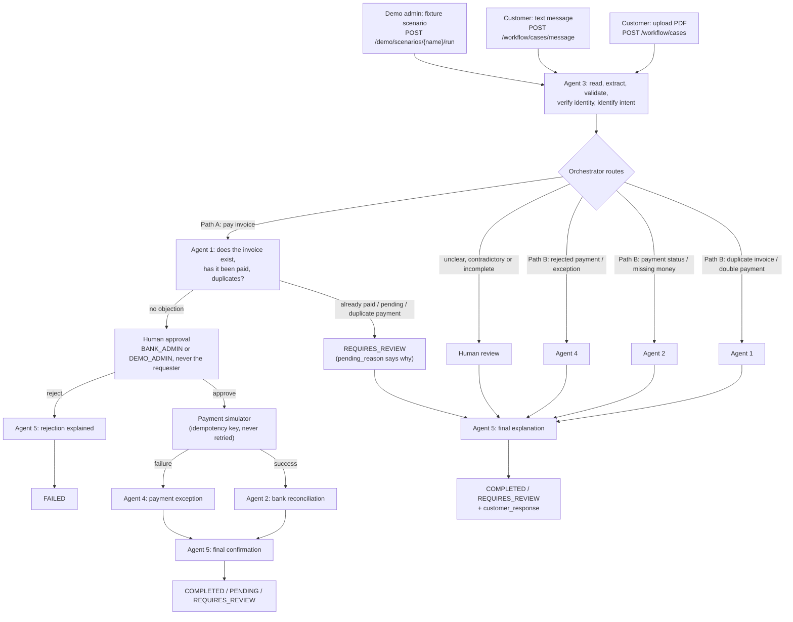

# GhostLedger - AI agents for invoice payments and customer support

A customer uploads a PDF **or sends a message**. Agent 3 reads it, extracts and
validates the facts, checks the customer's identity against stored records,
identifies the intent, and hands the case to the central orchestrator. The
orchestrator runs the specialists, enforces the bank-side approval gate, and
keeps a full audit trail. Agent 5 closes every case with a plain-language answer.

Everything is synthetic: the Mock Bank, its ledger and every payment are fictional.

## The real flow



Agent 1 always reports **before** a payment case can reach `AWAITING_APPROVAL`,
so the approver decides with its result in hand. A repeat submission of an
invoice that was never paid stays approvable: it reuses the original obligation
and the idempotency key lets it be paid exactly once.

## The agents

| Agent | Module | Responsibility |
| --- | --- | --- |
| **Agent 1** | `workflow/agent1_duplicates.py` | Duplicate invoices and duplicate payments: compares invoice numbers, parties, dates and amounts; checks prior payments. Runs before approval on Path A. Never refunds. |
| **Agent 2** | `workflow/agent2_reconciliation.py` | Reconciles payments against the Mock Bank ledger. A payment is never verified without a matching settled transaction. |
| **Agent 3** | `agent3/` | Intake and verification: LLM extraction, `Decimal` validation, identity check against stored records, intent, routing recommendation. |
| **Agent 4** | `workflow/agent4_exceptions.py` | Diagnoses failed, rejected and unresolved payments and recommends a resolution. Never retries. |
| **Agent 5** | `workflow/agent5_confirmation.py` | Final confirmation and customer answer on every path. Confirms a payment only after Agent 2 verified it. Moves no money. |
| Payment simulator | `workflow/payment_simulator.py` | The only component that moves (fictional) money, after a matching approval. |

None of the agents calls another directly; `workflow/orchestrator.py`
coordinates every handoff with typed `AgentReport` objects.

## Routing

| Intent | Path |
| --- | --- |
| `new_payment_request` | Agent 1 -> human approval -> simulator -> Agent 2 or Agent 4 -> Agent 5 |
| `duplicate_invoice` / `duplicate_payment` | Agent 1 (Agent 2 when settlements need verifying) -> Agent 5 |
| `bank_reconciliation` / `payment_status_dispute` | Agent 2 (Agent 4 if unresolved) -> Agent 5 |
| `payment_failure` | Agent 4 -> Agent 5 |
| `unknown` | Human review -> Agent 5 |

The LLM classifies the intent; Python validates it. A payment request goes to
human review when financial consistency failed, required fields are missing,
customer details contradict stored records, the document contains
contradictions, or it gives no amount, currency, payee or invoice number.

A **text message** is held to a stricter bar: it must contain an invoice number
(an identifier the customer did not write is discarded, never used) and a clear
request. A message only becomes a payment when it actually asks for one and
states the amount, currency and vendor. Otherwise it goes to human review with a
`pending_reason` naming what is missing.

## Safety properties

- Only a `BANK_ADMIN` or `DEMO_ADMIN` can approve or reject, never the account that requested the payment. The approver is the signed-in account, recorded in `approval.approved_by_account_id` and in the audit entry's `actor_account_id`; any `approved_by` in the request body is ignored.
- Nothing executes without an approval record bound to invoice number, payee, amount and currency; any mismatch blocks execution.
- Agent 1 only counts bank evidence that belongs to the invoice: a row naming the invoice, a payment reference known for it, or (for a row with no invoice label) the same amount with the invoice's vendor or customer as counterparty. A first-time payment request is held for review when such a settled payment already exists.
- Agent 1 reports before approval. `approve()` re-checks as defence in depth: a case without an Agent 1 report gets the full check, and every case is refused if a settled or pending attempt for the invoice appeared since.
- Payment attempts are keyed by `sha256(invoice|payee|amount|currency)`, `UNIQUE` in SQLite, so one obligation cannot be paid twice, even from different cases.
- A `PENDING` attempt blocks further execution. `FAILED` and `PENDING` are never recorded as completed. Nothing is retried automatically.
- Every case is owned by one account; customers see only their own cases, payments and history. The Mock Bank ledger and all cross-account views are admin-only.
- Every state change is in the case audit trail with actor, timestamps and, for human actions, the account id.
- Agent 5's `customer_response` is built from deterministic facts. An optional model may reword it, but any wording that claims a settlement that was not verified is discarded.

## Roles and routes

| Route | Anonymous | CUSTOMER | BANK_ADMIN | DEMO_ADMIN |
| --- | --- | --- | --- | --- |
| `GET /`, `GET /health`, `GET /workflow/agents` | yes | yes | yes | yes |
| `POST /auth/signup`, `POST /auth/signin`, `POST /auth/signout` | yes | yes | yes | yes |
| `GET /auth/me` | 401 | own history | all cases | all cases |
| `POST /workflow/cases` (upload) | 401 | yes | yes | yes |
| `POST /workflow/cases/message` | 401 | yes | 403 | 403 |
| `GET /workflow/cases` | `[]` | own | all | all |
| `GET /workflow/cases/{id}` (+ `/investigation`, `/receipt`) | 401 | own (else 404) | yes | yes |
| `POST /workflow/cases/{id}/execute` | 401 | own (else 404) | yes | yes |
| `POST /workflow/cases/{id}/approve`, `/reject` | 401 | 403 (404 if not theirs) | yes, not own request | yes, not own request |
| `GET /workflow/approvals` | 401 | 403 | yes | yes |
| `GET /workflow/invoices/{n}/payments` | 401 | attempts on own cases | all | all |
| `GET /workflow/invoice-history` | 401 | invoices on own cases | all | all |
| `GET /admin/payment-failures`, `/admin/activity`, `/admin/customers`, `/admin/overview` | 401 | 403 | yes | yes |
| `GET /demo/scenarios`, `POST /demo/scenarios/{name}/run` | 401 | 403 | 403 | yes |
| `GET /bank/ledger`, `/bank/ledger/{id}`, `/bank/transactions`, `POST /bank/reconcile`, `GET /workflow/bank-transactions` | 401 | 403 | yes | yes |
| `GET /customers`, `/customers/{id}`, `/agent3/results/{id}`, `/agent3/synthetic/*` | 401 | 403 | yes | yes |
| `POST /agent3/analyze` | yes | yes | yes | yes |
| `POST /bank/import` | developer key | developer key | developer key | developer key |
| `GET /developer/failure-scenarios`, `POST /developer/simulate-failure` | local requests only | same | same | same |

`/auth/signup` always creates a `CUSTOMER`; a `role` in the body is ignored.

## New and changed endpoints

The session token goes in `Authorization: Bearer <token>`.

### `POST /workflow/cases/message` (customer)

```json
{ "message": "Please pay invoice INV-7781 from Northstar Office Supplies LLC for 1,280.00 USD." }
```

`201` with the full case, run through the same Agent 3 analysis, ownership and
routing as an upload (`"source_channel": "message"`). An empty message is `400`;
over `MAX_MESSAGE_CHARS` (default 20,000) is `413`. An incomplete message:

```json
{
  "status": "REQUIRES_REVIEW",
  "pending_reason": "The message does not include an invoice number or a clear description of the problem (for example: pay an invoice, a payment that failed, or a payment you cannot see).",
  "customer_response": { "outcome": "NEEDS_REVIEW", "next_steps": ["Tell us the invoice number.", "A member of our team will review your request."] }
}
```

### `POST /workflow/cases/{id}/approve` and `/reject` (bank side)

Body (all optional): approve `{"note": "...", "simulate": "SUCCESS|FAILED|PENDING|PARTIAL|MISSING_SETTLEMENT"}`,
reject `{"reason": "..."}`. A customer gets:

```json
{ "detail": "Customers can request payments but cannot approve them. A bank administrator must approve or reject this payment." }
```

On success the approval records the signed-in account:

```json
"approval": {
  "approved_by": "Bank Administrator (18394418-793c-4854-9a73-0c8449731145)",
  "approved_by_account_id": "18394418-793c-4854-9a73-0c8449731145",
  "invoice_number": "INV-7781", "payee": "Northstar Office Supplies LLC",
  "amount": "1280.00", "currency": "USD", "note": "Checked vendor bank details"
}
```

### `GET /workflow/approvals` (admin)

```json
{
  "count": 1,
  "approvals": [{
    "case_id": "d7094325-...", "created_at": "2026-10-25T01:59:49+00:00",
    "requester": { "account_id": "6ac3896e-...", "display_name": "Demo Customer A", "email": "customer.a@ghostledger.test" },
    "invoice_number": "INV-7781", "vendor": "Northstar Office Supplies LLC", "amount": "1280.00", "currency": "USD",
    "agent1": {
      "status": "INSUFFICIENT_INFORMATION",
      "summary": "No comparison records are available, so Agent 1 cannot say whether this invoice is unique.",
      "previous_payment_status": null, "needs_human_judgement": true,
      "recommended_next_action": "...", "records_compared": 0, "completed_at": "2026-10-25T01:59:49+00:00"
    }
  }]
}
```

### `GET /workflow/cases/{id}`: new optional fields

```json
"approval_policy": {
  "required": true,
  "eligible_roles": ["BANK_ADMIN", "DEMO_ADMIN"],
  "requester": { "account_id": "6ac3896e-...", "display_name": "Demo Customer A", "email": "customer.a@ghostledger.test" },
  "blocked": [
    { "user": "Demo Customer A", "reason": "The account that requested a payment cannot approve it." },
    { "user": "CUSTOMER", "reason": "Customers can request payments but cannot approve them." }
  ]
},
"customer_response": {
  "case_status": "COMPLETED", "outcome": "PAID", "headline": "Payment confirmed",
  "answer": "Your payment of 1,280.00 USD for invoice INV-7781 to Northstar Office Supplies LLC is confirmed: the bank settled it and we matched it to your invoice. Receipt eb24c32e.",
  "next_steps": ["No action is needed.", "Keep the receipt for your records."],
  "payment_settled": true, "missing_information": [], "generated_by": "deterministic"
},
"source_channel": "message"
```

The case also carries `why`, `problems` and `next_action`: the same triage
values as the case list, so a client can explain a case before Agent 5 answers.
Receipts in `GET /auth/me` now include their `case_id`.

`customer_response` is set whenever a case ends (`COMPLETED`, `FAILED`,
`REQUIRES_REVIEW`, and `PENDING`). Outcomes: `PAID`, `PAYMENT_FOUND`,
`RESOLVED`, `PAYMENT_PENDING`, `REJECTED`, `PAYMENT_FAILED`,
`BLOCKED_DUPLICATE`, `DUPLICATE_CHECKED`, `FAILURE_CHECKED`,
`PAYMENT_NOT_FOUND`, `PAYMENT_DETAILS_NEEDED`, `NEEDS_REVIEW`. Only `PAID` and
`PAYMENT_FOUND` have `payment_settled: true`. Audit entries carry an optional
`actor_account_id`.

### `GET /admin/payment-failures`

```json
{ "simulated": true, "count": 2, "failures": [{
  "source": "ledger", "entry_id": "BK-AC8EBD9A039D44",
  "failure_code": "PAYMENT_REJECTED", "failure_reason": "The receiving bank rejected the transaction.",
  "invoice_number": "INV-7790", "amount": "2015.00", "currency": "USD", "payment_reference": "MB-3BAFCD7B348E",
  "at": "2026-10-25T01:59:51+00:00", "case_id": "02160480-...", "case_status": "REQUIRES_REVIEW",
  "customer": { "account_id": "6ac3896e-...", "display_name": "Demo Customer A", "name_on_document": "Blue Harbor Technologies Inc." }
}]}
```

Each failure appears once per source: the payment attempt (`"source": "payment_attempt"`) and the ledger row.

### `GET /admin/activity?limit=50`

Newest first across all cases (`limit` 1-500):

```json
{ "count": 1, "activity": [{
  "at": "2026-10-25T01:59:51+00:00", "case_id": "02160480-...", "invoice_number": "INV-7790",
  "customer": { "account_id": "6ac3896e-...", "display_name": "Demo Customer A", "name_on_document": "..." },
  "actor": "human_approval", "actor_account_id": "18394418-...",
  "action": "approved", "detail": "Bank Administrator (...) approved 2015.00 USD to ...", "status_after": "APPROVED"
}]}
```

### `GET /admin/customers`

```json
{ "count": 1, "customers": [{
  "account_id": "6ac3896e-...", "display_name": "Demo Customer A", "email": "customer.a@ghostledger.test",
  "created_at": "2026-10-25T01:59:47+00:00", "case_count": 3, "last_activity": "2026-10-25T01:59:51+00:00"
}]}
```

Never includes password hashes, salts or tokens.

### `GET /admin/overview`

```json
{
  "cases_total": 3,
  "cases_by_status": { "COMPLETED": 1, "REQUIRES_REVIEW": 2 },
  "cases_needing_a_person": 2,
  "payments": { "settled": 1, "failed": 1, "pending": 0 },
  "agent_runs": { "agent_1": 2, "agent_2": 1, "agent_3": 3, "agent_4": 1, "agent_5": 3,
                  "human_approval": 2, "human_review": 2, "payment_simulator": 2 }
}
```

`settled` counts attempts Agent 2 verified; a simulator success that is not yet
verified counts as `pending`.

### `GET /demo/scenarios` and `POST /demo/scenarios/{name}/run` (demo admin)

```json
{ "simulated": true, "scenarios": [{
  "name": "normal_invoice.pdf",
  "description": "A clean, internally consistent invoice (INV-2026-0441, 410.40 USD) to pay.",
  "available": true,
  "expected": { "route": "new_payment_request", "status": "REQUIRES_REVIEW",
                "agents": ["agent_3", "agent_1", "agent_5", "human_review"], "outcome": "BLOCKED_DUPLICATE" }
}]}
```

Run body (all optional): `{"customer_email": "customer.a@ghostledger.test"}` or
`{"customer_account_id": "..."}` (defaults to the first customer account), and
`{"mode": "scripted" | "live"}`. The response is the case. The fixture PDF goes
through the real pipeline; in the default `scripted` mode the model's reading is
a stored reply from `workflow/demo_scenarios.py`, labelled
`analysis_source: "synthetic_fixture"` with `llm_call.invoked: false`. `live`
uses the configured model (`409` if none). Each run is audited as `demo_run`
with the demo admin's account id. `expected` is pinned by
`tests/test_demo_scenarios.py` from a run on a fresh database. Outcomes on a
database with earlier runs can differ. `normal_invoice.pdf` is blocked because
the synthetic bank seed already holds a settled payment for INV-2026-0441.

### Access fixes

`POST /workflow/cases/{id}/execute` and `GET /workflow/invoices/{n}/payments`
now need a signed-in account and are scoped to the owner (admins see all).
`GET /customers`, `/customers/{id}`, `/agent3/results/{id}` and
`/agent3/synthetic/*` are admin-only. `GET /workflow/invoice-history` scopes a
customer by the invoices on their own cases, not by display name (which anyone
can choose at signup).

## Demo accounts

Public signup only creates customers. Create the bank-side accounts with:

```powershell
cd backend
$env:DEMO_ACCOUNT_PASSWORD = "choose-a-password"   # optional
python -m tools.seed_demo_accounts                  # or: --db path\to\agent3.db
```

| Email | Role |
| --- | --- |
| `demo.admin@ghostledger.test` | `DEMO_ADMIN` |
| `bank.admin@ghostledger.test` | `BANK_ADMIN` |
| `customer.a@ghostledger.test` | `CUSTOMER` |
| `customer.b@ghostledger.test` | `CUSTOMER` |

Or let the backend do it: with `GHOSTLEDGER_DEMO_ACCOUNTS=1` in `.env` (already
in `.env.example`), the same four accounts are created when the API starts, so a
fresh clone can sign in without running the tool.

Without `DEMO_ACCOUNT_PASSWORD` the local default `ghostledger-demo` is used and
printed. Running it again changes nothing and never resets a password. It
refuses to run when `GHOSTLEDGER_ENV=production`. The database is
`AGENT3_DB_PATH` (default `data/agent3.db`), the same file the API uses.

## Case statuses

`RECEIVED -> ANALYZING -> ROUTED -> INVESTIGATING -> AWAITING_APPROVAL ->
APPROVED -> EXECUTING -> PENDING -> COMPLETED | FAILED | REQUIRES_REVIEW`

## Workflow tests

`tests/test_diagram_conformance.py` turns the product diagram into acceptance
tests over HTTP, one per path, asserting the exact order and status of every
step: Path A success and payment failure, a duplicate invoice flagged before
approval, a customer-reported duplicate invoice, a duplicate payment, a payment
status dispute, a rejected payment, a text message, and human review; plus
Agent 1 reporting before approval, customers unable to approve or see the
ledger, and one customer unable to read another's case.

Also: `test_agent1_before_approval.py`, `test_customer_response.py`,
`test_bank_side_approval.py`, `test_message_cases.py`, `test_route_access.py`,
`test_admin_endpoints.py`, `test_demo_scenarios.py`,
`test_seed_demo_accounts.py`, and the earlier `test_workflow.py`,
`test_workflow_architecture.py` and `test_agent_order.py`.

# GhostLedger — Agent 3: Customer Document Understanding

Agent 3 reads a customer PDF, sends its extracted text to a configured
OpenAI-compatible LLM, validates the returned claims independently in Python,
and stores a structured result.

It does **not** route work to other agents, and it does **not** make financial,
identity, payment, or refund decisions. A reported problem stays reported until
something outside this component confirms it.

## Workflow

```
PDF upload → PyMuPDF text extraction → LLM analysis → Python validation → structured JSON
```

Open `http://127.0.0.1:8000` to use the dashboard: upload a PDF, press **Analyze
with AI**, then inspect the extracted customer information, the financial
problem the model detected, the validation findings, the supporting excerpts
with page numbers, and the full JSON.

## Setup

From `ghostledger/backend` in PowerShell:

```powershell
python -m venv .venv
.\.venv\Scripts\Activate.ps1
python -m pip install --upgrade pip
pip install -r requirements.txt
Copy-Item .env.example .env    # then edit .env
python -m uvicorn main:app --reload
```

Configure any Chat Completions compatible endpoint in `.env`:

```dotenv
LLM_API_KEY=your_key
LLM_BASE_URL=https://api.openai.com/v1
LLM_MODEL=gpt-4o-mini
LLM_RESPONSE_FORMAT=json_schema
LLM_TIMEOUT_SECONDS=60
```

- `LLM_RESPONSE_FORMAT=json_schema` (default) requests Structured Outputs.
- Use `json_object` only for a provider without Structured Outputs; the reply is
  still parsed and validated with Pydantic either way.

### Current configuration: xAI Grok (hosted, fast)

`.env` currently points at the xAI OpenAI-compatible API:

```dotenv
LLM_API_KEY=xai-...
LLM_BASE_URL=https://api.x.ai/v1
LLM_MODEL=grok-4.20-0309-non-reasoning
LLM_RESPONSE_FORMAT=json_object
LLM_TIMEOUT_SECONDS=180
```

A typical document is analysed in **4-6 seconds**. Model choice matters: with the
full Agent 3 prompt, `grok-4.20-0309-non-reasoning` returned correct customer
and vendor roles and `primary_problem: duplicate_payment`, while `grok-4.6`
(reasoning) also worked but took ~76 s and consumed ~5,900 reasoning tokens per
document.

### Running fully locally with Ollama (no API key, no cost)

This is the configuration currently in `.env`. Install
[Ollama](https://ollama.com/download), then pull a model:

```powershell
ollama pull qwen3:4b
```

and point `.env` at it:

```dotenv
LLM_API_KEY=ollama                  # placeholder; Ollama needs a non-empty key
LLM_BASE_URL=http://127.0.0.1:11434/v1
LLM_MODEL=qwen3:4b
LLM_TIMEOUT_SECONDS=900
LLM_MAX_TOKENS=2048
```

When `LLM_BASE_URL` points at a local Ollama server, Agent 3 automatically uses
Ollama's **native `/api/chat` API** rather than the OpenAI-compatible `/v1`
endpoint. This is required, not cosmetic: `/v1` cannot disable reasoning for
thinking models such as qwen3, so the entire token budget is spent in an
internal `reasoning` field and `content` comes back empty. The native API
accepts `think: false` together with `format: "json"`, which returns usable JSON.

**Expect roughly 5 minutes per document.** CPU inference measured about 5
tokens/sec, and a full extraction needs ~1,400 output tokens. Raise
`LLM_TIMEOUT_SECONDS` for longer PDFs. A hosted provider is much faster if
latency matters.

### No silent fallback

If `LLM_API_KEY` or `LLM_MODEL` is missing, or the provider fails, the API
returns a result with:

- `analysis_source: "unavailable"`
- `validation.status: "extraction_failed"`
- `processing_errors` naming the actual failure
- every extracted field left `null`

Nothing is ever invented to fill the gap. `GET /health` reports whether a live
model is configured **before** you upload anything, and the UI shows the same
state in its header pill.

## API

| Method | Path | Purpose |
| --- | --- | --- |
| `POST` | `/agent3/analyze` | Multipart upload, one PDF in field `file` |
| `GET` | `/agent3/results/{document_id}` | Fetch a saved result by record or document ID (admins only) |
| `GET` | `/customers` | List the fictional reference records used for matching (admins only) |
| `GET` | `/customers/{customer_id}` | Fetch one reference record (admins only) |
| `GET` | `/health` | Live-model state, model name, reference-customer count |
| `GET` | `/agent3/synthetic/*` | Development corpus and evaluation (not in the UI; admins only) |

The synthetic corpus and its evaluation endpoint remain available for
development. They never cause an unavailable live analysis to be presented as a
model result.

## Output

Abridged response for the reported overpayment case (a $2,700 invoice with a
reported $3,200 payment):

```json
{
  "customer_information": { "customer_name": "Blue Harbor Technologies" },
  "vendor_information": { "vendor_name": null },
  "document_information": {
    "document_type": "invoice",
    "document_number": "INV-2026-1042",
    "issue_date": "12 Jan 2026",
    "due_date": "11 Feb 2026",
    "currency": "USD"
  },
  "financial_information": {
    "currency": "USD",
    "subtotal": "2500.00",
    "tax_amount": "200.00",
    "total_amount": "2700.00",
    "amount_paid": "3200.00",
    "outstanding_balance": "500.00",
    "payment_claim": {
      "claimed_amount": "3200.00",
      "status": "reported",
      "requires_reconciliation": true,
      "note": "The customer reports having paid; no payment artefact supports the claim."
    }
  },
  "detected_problem": {
    "type": "payment_status_discrepancy",
    "description": "The customer says the invoice was already paid.",
    "source_evidence": "I have already paid this invoice in full.",
    "page": 1,
    "status": "reported"
  },
  "validation_findings": [
    { "code": "subtotal_tax_total", "label": "Subtotal + tax = invoice total",
      "status": "passed", "explanation": "Subtotal 2500.00 plus tax 200.00 equals the stated total 2700.00." },
    { "code": "overpayment_detected", "label": "Overpayment check",
      "status": "failed", "explanation": "The reported payment 3200.00 exceeds the invoice total 2700.00 by 500.00.",
      "variance": "500.00" },
    { "code": "payment_verification", "label": "Payment verification",
      "status": "unverified", "explanation": "The payment of 3200.00 is reported … it must be reconciled." }
  ],
  "validation": {
    "financial_consistency": "failed",
    "customer_verification": "unverified",
    "payment_provenance": "reported",
    "requires_reconciliation": true,
    "calculated": { "potential_overpayment": "500.00" }
  },
  "routing": {
    "recommended_agent": "agent_2",
    "agent_name": "Agent 2 (Bank Reconciliation Specialist)",
    "reason": "Agent 2 should reconcile the money trail because a potential overpayment of 500.00 USD; the reported payment of 3200.00 is reported and not verified.",
    "blocking": true
  },
  "reasoning": ["…one line per step Agent 3 took…"],
  "missing_information": [],
  "requires_review": true
}
```

Amounts serialize as **strings**, never floats. Full responses also carry
`source` (filename, page count, hash), `evidence`, `contradictions`, and
`llm_call` — the audit trail showing whether a real request happened:

```json
"llm_call": {
  "invoked": true,
  "provider_response_id": "…",
  "model": "qwen3:4b",
  "usage": { "prompt_tokens": 1574, "completion_tokens": 1431, "total_tokens": 3005 }
}
```

`reasoning` explains every step in plain language, so the routing decision is
auditable rather than a bare label.

## What the LLM does, and what Python does

**The model** reads the document and reports document type, customer details,
references, financial figures, the reported financial problem, contradictions,
missing fields, and which claims need verification. The prompt is written to
make it *read* rather than pattern-match: a payment dispute inside an invoice is
`payment_status_discrepancy`, not `none_identified`.

**Python decides the truth of the arithmetic, the payment status, and the
identity.** The model is never the source of truth for any of them:

- **Financial consistency** — `subtotal − discount + tax = total`,
  `total − payments = outstanding`, each line item's `quantity × unit_price`,
  and currency-precision-aware tolerance. All money is `Decimal`, never float.
- **Overpayment detection** — when the reported payment exceeds the invoice
  total, the difference is reported as `potential_overpayment`.
- **Payment provenance** — a payment the document mentions is a *claim*. It is
  `reported` (customer assertion), `document_supported` (a receipt or
  remittance advice is referenced), or `verified` (matched to an independent
  source). Agent 3 has no independent source, so nothing is `verified` here and
  every claimed payment requires reconciliation before it may clear a balance.
- **Date consistency** — recognizable calendar dates in any common format, and
  due date not before issue date.
- **Required fields** — per document type. A missing total or currency is a
  `FAILED` financial result, never a pass.
- **Customer verification** — exact matching against stored reference records
  only, by customer ID or by name plus company, or by email. No fuzzy matching.
- **Duplicates** — by file hash and by document metadata.
- **Routing** — Agent 2 for anything needing a money trail, Agent 3 for
  unresolved verification, or no further agent when nothing is outstanding.

### How field recovery works

A grounded model value always wins. When the model returns `null` for a money
field or the currency, the value is recovered deterministically from the
document's own labelled line (`_AMOUNT_LABELS` in `extractor.py`), and every
recovery is recorded in `processing_errors`. Recovery understands alternative
labels — "Net Amount", "GST", "Grand Total", "Total Payable", "Remittance",
"Balance Owing" — and prefers the payable amount over a pre-discount total.

Model-supplied numbers are matched against every figure printed in the
document, compared *by value* rather than by string. This lets a correct
`2700.00` from the model match a printed `$2,700.00` instead of being discarded
as unsupported. Printed placeholders such as `-`, `N/A`, or "Not provided" are
treated as missing rather than becoming a customer identity. Evidence excerpts
must be exact quotes, tolerant only of line wrapping; the page number is
recomputed from the PDF, never taken on trust.

### Routing

The customer's **primary reported problem** selects the first specialized
agent. Overpayment amounts and failed arithmetic raise priority and add a
secondary Agent 2 step, but they never displace the primary agent.

| Primary problem | First agent |
| --- | --- |
| `duplicate_invoice` | Agent 1 (Duplicate Invoice Investigator) |
| `duplicate_payment` | Agent 1 (Duplicate Invoice Investigator) |
| `bank_reconciliation` | Agent 2 (Bank Reconciliation Specialist) |
| `payment_failure` | Agent 4 (Payment Failure Specialist) |
| `payment_request` | Human approval, then Agent 5 |
| `unknown` | Human review / clarification |

Agent 1 receives Agent 2 as a **secondary** investigation when bank-record
verification is still needed, rather than being replaced by it. A duplicate is
always reported as alleged, never confirmed.

The model classifies `primary_problem`; Python validates it. An explicit
`unknown` from the model is respected and escalates to human review. Only when
the model supplies no classification at all does Agent 3 infer one from the
document's wording, and the result is then marked `overridden: true`.

### Financial status values

| Status | Meaning |
| --- | --- |
| `passed` | Arithmetic reconciles and no payment claim is outstanding |
| `failed` | A numeric conflict, overpayment, or missing required field |
| `unverified` | Arithmetic reconciles but rests on an unconfirmed payment |
| `not_available` | The document carries no financial figures |
| `requires_review` | Review needed; used for extraction failures |

Each entry in `validation_findings` carries its own
`passed` / `failed` / `unverified` / `not_applicable` status with a plain-language
explanation, expected value, reported value, and variance.

## PDF handling

PyMuPDF extracts text page by page and inserts `[Page N]` markers so evidence
citations can be traced. Handled explicitly:

- **Multi-page** — all pages extracted and cited by page.
- **Empty / image-only / scanned** — a clear needs-OCR error (HTTP 400). No OCR
  or vision model is configured by default.
- **Corrupted** — a safe read error, never a crash.
- **Missing information** — reported in `missing_information` and
  `validation.missing_fields`, never filled in.
- **Oversized text** — extracted text beyond `MAX_TEXT_CHARS` (default
  1,000,000) is rejected with a clear error rather than sent as a huge prompt.

## Tests

```powershell
python -m pytest -q
```

120 tests collected: 118 run by default, and the 2 live-provider tests are skipped
unless explicitly enabled. The suite mocks only the remote LLM boundary and
covers the scenarios in `tests/test_scenarios.py` against generated fictional
PDFs in `fixtures/pdfs/`:

| Fixture | Scenario |
| --- | --- |
| `normal_invoice.pdf` | Normal, internally consistent invoice |
| `payment_dispute.pdf` | Customer says a paid invoice still shows unpaid (2 pages) |
| `refund_request.pdf` | Refund request |
| `missing_customer_information.pdf` | No customer identifying fields |
| `contradictory_financials.pdf` | Totals that cannot all be correct |
| `unknown_document_type.pdf` | Unfamiliar document with no financial content |
| `unseen_letter.pdf` | Unfamiliar letter wording and layout |
| `corrupted.pdf` | Deliberately invalid PDF |

Also covered: provider HTTP failures, unreachable providers, malformed JSON,
prompt-injection attempts, placeholder customer values, hallucinated figures
being discarded, and the exact JSON contract.

Regenerate the fictional PDFs at any time:

```powershell
python tools/generate_fixture_pdfs.py
```

`tests/test_llm_client.py` runs the real OpenAI SDK against a local HTTP server
speaking the Chat Completions protocol, so the request shape (structured output,
document framed as data) and response handling (response ID, token usage) are
verified without contacting a provider.

### Live integration test

The only test that contacts a real provider, in
`tests/test_live_llm_integration.py`:

```powershell
$env:RUN_LIVE_LLM_TEST = "1"
python -m pytest -m integration -v
```

It requires `LLM_API_KEY`, `LLM_BASE_URL`, and `LLM_MODEL`, and asserts a
provider-assigned response ID plus non-zero token usage — proving a genuine
model request was made rather than a canned reply. It is skipped by default so
the normal suite sends no data and incurs no usage.
